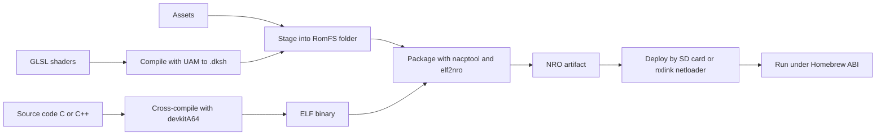
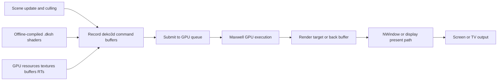

# Designing a Lawful, Permissive Nintendo Switch Homebrew Development Document

## Executive summary

A rigorous Nintendo Switch development document that stays on the lawful side of the line should be written as a **public homebrew platform document**, not as a surrogate for Nintendo’s official developer materials. The defensible public stack is centred on **devkitPro**, **libnx**, and—depending on the rendering strategy—either **deko3d** for low-overhead native-style graphics or **SDL2 plus the public OpenGL stack used in the homebrew ecosystem** for portability. That stack is openly documented, does not require Nintendo NDAs, and is explicitly positioned by devkitPro as a way to build homebrew without official console SDK access. citeturn27search1turn28search1turn29search0turn32search0

The single most important legal distinction is this: **writing and distributing your own original homebrew code is not the same thing as distributing circumvention tools, leaked SDK material, or dump/piracy tooling**. Nintendo’s official route for commercial Switch development runs through the Nintendo Developer Portal and a Switch access request; Nintendo also warns that modified consoles and unsupported software can cause systems to stop functioning correctly after updates and may void warranty coverage. In parallel, anti-circumvention rules in the United States, EU, and UK protect technological measures, while interoperability exceptions exist but are narrow and highly fact-specific. A compliant document therefore needs a **bright-line rule**: use only public documentation, clean-room reverse engineering results, original code, and original assets; exclude exploit instructions, bypass tooling, and anything derived from leaked Nintendo SDKs or NDA content. citeturn16search0turn15search0turn15search5turn16search1turn17search1turn18search0turn21search3

Technically, the present public-homebrew reality is also clear. Nintendo’s public hardware pages still describe the CPU/GPU broadly as an **“NVIDIA customised Tegra processor”**, while public reverse-engineering and NVIDIA-derived hardware documentation identify the Switch family as Tegra X1/X1+ based, with **4 GB RAM across retail Switch, Lite, and OLED retail units**, 32 GB internal storage on the standard/Lite models and 64 GB on OLED, and distinct public board generations commonly called **Erista** and **Mariko**. Current public firmware support pages list **system version 22.1.0** as the latest Switch firmware as of 7 April 2026, and public homebrew APIs are version-gated across Horizon OS releases. citeturn39view0turn42view0turn25search2turn25search0turn15search5turn12search3

For a development document, the safest default recommendation is to target **advanced hobbyist or professional C/C++ developers**, assume **homebrew distribution rather than eShop release**, prefer **application-mode execution over applet mode** for serious software, choose **deko3d** when performance and binary size matter most, choose **SDL2/OpenGL** when cross-platform code reuse matters most, and keep every shipped runtime dependency under a permissive or licence-free licence. The main unresolved variables are the intended audience skill level, the performance target, and whether any commercial release is intended. Those variables materially change what “best practice” means. citeturn14search2turn22search0turn29search0turn31search0turn16search0

## Scope and unspecified constraints

This report is written for a document that covers **publicly documented Switch homebrew**, not Nintendo-authorised commercial SDK work. It intentionally excludes instructions for exploiting retail hardware, defeating signature checks, installing modchips, distributing payloads, or handling commercial game dumps. That exclusion is not cosmetic; it is what keeps the document aligned with public documentation, Nintendo’s official developer-access model, and anti-circumvention law. citeturn16search0turn15search0turn16search1turn17search1turn18search0turn11search0

Three design constraints are still unspecified and should be declared near the top of the final development document:

### Open questions and limitations

The first unresolved question is **who the document is for**. A document for experienced engine programmers can assume familiarity with command buffers, asset baking, and ABI hygiene; a document for hobbyists should bias much more heavily towards SDL2, sample templates, and desktop-first debugging. The public sources gathered here support both styles, but they do not eliminate that editorial choice. citeturn27search3turn29search0turn31search0

The second is **what performance and quality target is expected**. A 2D SDL title at 720p with limited overdraw has very different engineering needs from a 3D renderer attempting stable 60 fps in both handheld and docked modes. Switch performance configurations, GPU clocks, memory clocks, and thermal throttling states are all real constraints, and they should appear as explicit assumptions rather than hidden background knowledge. citeturn24view2turn24view3turn22search0turn42view0

The third is **whether commercial release is intended**. If the answer is yes, the public homebrew stack is useful for prototyping, research, and internal tooling, but it is not the authorised shipping path for Nintendo platforms. Nintendo’s official developer portal makes clear that access to Switch development and publishing resources requires registration and an approved Switch access request. citeturn16search0

## Hardware baseline and firmware envelope

Nintendo’s currently published public hardware pages cover the commercial retail family as **Nintendo Switch – OLED Model**, **Nintendo Switch console (HAC-001(-01))**, and **Nintendo Switch Lite (HDH-001)**. Publicly, Nintendo exposes screen size and resolution, storage, communications, output modes, and the generic CPU/GPU description; more specific SoC and RAM details are supplied by public hardware research and NVIDIA-derived Tegra documentation rather than Nintendo’s consumer-facing spec sheet. citeturn39view0turn42view0turn25search2turn25search0

| Model | Public model identifier | Public Nintendo CPU/GPU description | Publicly documented SoC generation | RAM | Internal storage | Display | Operational notes |
|---|---|---:|---:|---:|---:|---:|---:|
| Switch launch model | HAC-001 | “NVIDIA Custom Tegra processor” is Nintendo’s public wording for the family; launch-specific consumer specs are no longer foregrounded on current pages | Public homebrew/research literature identifies early retail units as **Erista / Tegra X1 / ODNX02-A2** | 4 GB LPDDR4 | 32 GB eMMC | 6.2" LCD, 1280×720 | Earliest retail board generation; homebrew documentation commonly distinguishes it from Mariko on power/security grounds. citeturn39view0turn25search2turn25search0 |
| Switch battery-revised model | HAC-001(-01) | NVIDIA customised Tegra processor | Public homebrew/research literature identifies this generation as **Mariko / Tegra X1+ family / ODNX10-A1 board line** | 4 GB LPDDR4X | 32 GB | 6.2" LCD, 1280×720 | Same retail class, improved efficiency, same public 1080p TV / 720p handheld output targets. citeturn39view0turn25search2turn25search0 |
| Switch Lite | HDH-001 | NVIDIA Custom Tegra processor | Public hardware research identifies Lite retail boards as **ODNX10-A1 / Mariko family** | 4 GB LPDDR4X | 32 GB | 5.5" LCD, 1280×720 | Handheld-only; USB-C used for charging only; no docked TV mode. citeturn39view0turn25search2 |
| Switch OLED | HEG family retail board | NVIDIA customised Tegra processor | Public hardware research identifies OLED retail boards as **ODNX10-A1 / Mariko family** | 4 GB LPDDR4X | 64 GB | 7.0" OLED, 1280×720 | Dock supports wired LAN; same basic output ceiling of 1080p TV mode. citeturn39view0turn42view0turn25search2 |

The broad Tegra X1 public hardware picture is consistent across public sources: **four Cortex‑A57 cores plus four Cortex‑A53 cores**, a **256-core Maxwell GPU**, and a **64-bit LPDDR memory interface**. Nintendo does not publish those details on the consumer-facing spec page, but the public Tegra X1 material and Switchbrew hardware pages do, and they are the basis for the homebrew ecosystem’s technical assumptions. citeturn25search0turn25search1

For software planning, the public APM/PTM documentation is more useful than the raw SoC description because it shows the real operating envelope the OS exposes. Publicly documented performance configurations include combinations such as **CPU 1020 MHz / GPU 307.2 MHz / memory 1331.2 MHz** as a default-like configuration, higher GPU states such as **460.8 MHz**, a **768 MHz dock-only GPU state**, and CPU boost configurations up to **1785 MHz** coupled to very low GPU clocks for fast-load scenarios. Switchbrew also documents that some performance configurations are dock-only and that throttling state is surfaced through APM. citeturn24view0turn24view1turn24view2turn24view3turn22search0

That means a serious development document should not talk about “the Switch” as if it had one fixed performance profile. It should instead define a **minimum tested mode** and a **preferred mode**. A practical public-homebrew baseline is to design first for **720p handheld stability**, then scale to docked rendering when profiling justifies it. Nintendo’s own public consumer pages make clear that the hardware fundamentally targets **720p on the built-in display** and **up to 1080p in TV mode**. citeturn39view0turn42view0

Firmware also matters. Nintendo’s official support pages list **22.1.0** as the latest Switch firmware as of 7 April 2026, while Switchbrew’s system-version tables show long-term service/API evolution over time. In libnx documentation, many APIs are explicitly marked with minimum Horizon OS versions, which means a robust public-homebrew codebase should declare a minimum supported HOS version and gate newer APIs at runtime rather than assuming the latest firmware everywhere. citeturn15search5turn12search3turn22search2turn36search0

## Lawful development and licensing analysis

The clean legal boundary is straightforward. **Official Nintendo development resources** are obtained through the Nintendo Developer Portal, where developers register and then apply for Switch access. If the aim is an authorised commercial Switch release, that is the proper path. The public-homebrew stack does not replace it, and a development document should say so explicitly. citeturn16search0

A separate, lawful-public path exists for **independently created homebrew** built from public tools and public documentation. devkitPro explicitly describes its mission as letting programmers build homebrew for Nintendo-family consoles without buying dedicated hardware or signing NDAs, and libnx is an ISC-licensed public userland library. That is the ecosystem this report is about. citeturn27search1turn28search1

The legal danger zone begins when homebrew work crosses into **circumvention, bypass tooling, or unauthorised use of protected materials**. In the United States, 17 U.S.C. §1201 prohibits circumvention of effective access controls and also targets trafficking in circumvention technology. The EU InfoSoc Directive requires Member States to protect effective technological measures, and the UK’s copyright framework similarly protects effective technological measures and devices/services that facilitate circumvention. Those provisions do not outlaw all reverse engineering or all interoperability work, but they do mean that a public development document should avoid instructing readers how to defeat retail console protections. citeturn16search1turn17search1turn18search0

Interoperability exceptions are real, but narrow. U.S. law contains a specific interoperability carve-out in **17 U.S.C. §1201(f)**, and EU software law allows certain acts of decompilation where they are indispensable to obtain information necessary for interoperability with an independently created program. Those provisions support the existence of clean-room interoperability research, but they do **not** amount to a blanket permission to copy Nintendo SDK content, distribute bypass devices, or ship materially similar proprietary implementations. A careful development document should frame public reverse engineering as **clean-room, necessity-limited, interoperability-focused work**, not as a free-for-all. citeturn16search1turn21search3

Nintendo’s own support pages reinforce the practical risk. Nintendo warns that modified consoles or unsupported accessories/software may become unresponsive after updates, that unsupported save data may be removed, and that warranty coverage may be voided. That is not a criminal-law statement, but it is a strong operational warning and should appear in any honest risk section. citeturn15search0turn15search5

A defensible compliance policy for the document is therefore:

| Practice | Status for a lawful public document | Why |
|---|---|---|
| Use devkitPro, libnx, deko3d, SDL2 and other public permissive libraries | Recommended | Publicly documented, openly licensed, no Nintendo NDA path required for access. citeturn27search1turn28search1turn29search0turn31search0 |
| Use only original code, original assets, and clean-room notes | Recommended | Minimises copyright and provenance risk. Supported by the narrow interoperability framing in U.S./EU law. citeturn16search1turn21search3 |
| Use leaked Nintendo SDKs, NVN headers, docs, symbols, or binaries | Do not do this | Outside the authorised Nintendo developer-access path and likely to create copyright/contract/provenance problems. citeturn16search0 |
| Include exploit steps, jailbreak guides, signature-bypass instructions, or dump tooling | Exclude from the document | Anti-circumvention law and Switchbrew’s own note about dump/dump-tool promotion make this a high-risk area. citeturn16search1turn17search1turn18search0turn11search0 |
| Plan for eShop/commercial release using only public homebrew SDKs | Not recommended | Operationally misaligned with Nintendo’s official publishing route. citeturn16search0 |

For open-source licence compliance, the best approach is conservative and mechanical. Keep a **third-party notices file** in the repository and in distributed packages; pin exact versions of third-party dependencies; record the licence of each runtime library; and exclude strong-copyleft runtime dependencies if the document’s requirement is “permissive or licence-free only”. It is also worth stating one nuance explicitly: the public runtime stack can be permissive even if the **build toolchain around it is not wholly permissive**. For example, devkitPro’s ecosystem includes GPL-licensed tooling such as pacman, but that does not by itself convert your game into GPL software. Still, if the requirement is interpreted to include every build tool, then the public ecosystem is **not** purely permissive end-to-end. citeturn38search1turn27search1turn28search1

## Public homebrew stack and build toolchains

The strongest public-source-backed workflow is the **devkitPro + devkitA64 + switch-dev + libnx** path, because that is the route used by the public examples and ecosystem packages. devkitPro distributes toolchains and libraries through pacman, and the public examples repository is explicitly for “Switch using devkitA64 and libnx”. libnx is the AArch64-only userland library that exposes Horizon OS services, filesystem, HID, audio, networking, and other public homebrew interfaces. citeturn27search1turn32search0turn27search3turn28search1

The conceptual build flow for a high-quality public-homebrew project should look like this:



That flow is grounded in public tooling. deko3d’s shader compiler **UAM** is a PC tool that compiles shaders ahead of time to **`.dksh`**, and public examples of packaging show **`nacptool`**, **`elf2nro`**, and optionally **`nxlink`** for deployment/logging. Homebrew Menu also documents network loading through netloader and nxlink. citeturn29search0turn30search6turn34search0turn27search0

The most useful comparison for a development document is not “which compiler is fastest”, but “which workflow is most supportable with public evidence”:

| Workflow | Evidence quality | Strengths | Weaknesses | Licensing posture |
|---|---|---|---|---|
| Make + devkitPro rules + libnx | Strongest | Best aligned with public examples and public package ecosystem; least ambiguity | Less fashionable than modern meta-build systems | Public SDK/runtime layers are permissive; surrounding tooling is not wholly permissive. citeturn27search3turn28search1turn32search0turn38search1 |
| Make + libnx + deko3d + UAM | Strongest for 3D | Lowest public CPU overhead, best hardware-facing control, small binaries, compile-time shader pipeline | More platform-specific, more engine work, less portable | libnx ISC, deko3d zlib; UAM tool exists publicly but this report did not independently verify its licence text. citeturn28search1turn29search0turn30search6 |
| SDL2-based workflow via devkitPro packages | Good | Cross-platform application code, easier ports, good for 2D/UI/tools | Homebrew Switch support is not an upstream SDL target in the gathered sources; binary/code-size overhead higher than deko3d | SDL2 is zlib; Switch support is ecosystem-packaged rather than first-party upstream. citeturn31search0turn32search2turn32search0 |
| Meson/CMake variants | Mixed | Team familiarity, CI integration | Public documentation gathered here is sparse compared with Make-based examples | Treat as secondary unless your team already standardises on them. citeturn38search0turn27search3 |

Cross-compilation itself should be described very plainly in the final document: host development is on Windows, macOS, or Linux; the target is **AArch64 Horizon userland**; and the public SDK layer is **libnx**. Keep the host build and the Switch build in the same repository, but not in the same binary artefact. In practice, the best debugging accelerator is to maintain a **desktop twin build** for gameplay logic and tools, then use the Switch build for platform integration, memory pressure, input, audio, and GPU validation. That recommendation is partly an engineering inference, but it is supported by the public ecosystem’s emphasis on netloader, desktop-side tools, and compile-time asset processing. citeturn28search1turn29search0turn27search0

## Runtime architecture and performance engineering

### Filesystem paths and conventions

Public homebrew conventions are simple but important. Homebrew applications are typically placed in the SD card’s **`switch/`** folder, either directly as **`sdmc:/switch/<app>.nro`** or in a same-name subdirectory when the app relies on its working directory. Homebrew Menu scans the SD card for `.nro` files, and its own configuration paths include **`/config/nx-hbmenu/themes/`** and **`/config/nx-hbmenu/fileassoc/`** on the SD card. citeturn11search0turn11search1

libnx’s filesystem device layer then turns those conventions into mountable devices. **`fsdevMountSdmc()`** mounts the SD card, **`fsdevMountSaveData()`** and related functions mount save and cache storage, **`fsdevMountDevice()`** allows custom device names, and **`fsdevCommitDevice()`** must be called after save-data writes because committing is not automatic at unmount. Mount names are therefore best understood as **conventions chosen by the application**, not fixed magical kernel paths, with `sdmc:` and `save:` as sensible defaults. citeturn35view2turn35view4

For immutable packaged assets, the cleanest public path is **RomFS**. libnx exposes **`romfsMountFromCurrentProcess()`**, and public packaging examples use **`elf2nro --romfsdir=<dir>`** to bake a RomFS image into the NRO. A good development document should therefore recommend this split:

| Path or prefix | Use | Guidance |
|---|---|---|
| `sdmc:/switch/<app>.nro` | executable deployment | Standard Homebrew Menu discovery path. citeturn11search0 |
| `sdmc:/switch/<app>/...` | development-only external data, mods, logs, screenshots, test content | Useful for hot-swapping assets and debug output. citeturn11search0turn35view2 |
| `romfs:/...` | immutable shipped content | Preferred for production assets and data tables that should version with the executable. The exact mount label is application-chosen; `romfs` is the common convention. citeturn36search4turn34search0 |
| `save:/...` or another app-chosen save mount | persistent user data | Commit after writes with `fsdevCommitDevice()`. citeturn35view2turn35view4 |

### Threading, memory, storage I/O, and input

libnx provides first-class public primitives for threads, mutexes, condition variables, events, JIT buffers, virtual memory, and timers. Thread creation takes an explicit stack pointer or can auto-allocate one, and custom stacks must be page-aligned. Mutexes and condvars are conventional POSIX-like primitives in shape, which means a document can recommend a familiar model: one main thread, one render thread only if the graphics backend genuinely benefits, and a small worker pool for streaming, decode, and network work. citeturn10search2turn10search3turn10search0turn36search0

For JIT or dynamic code generation, public support exists but is constrained. libnx exposes **`jitCreate`**, writable/executable transitions, and two JIT implementation types, while the Homebrew ABI explicitly notes that privileged syscall availability is not guaranteed and can be hinted by the loader. In plain terms: do not make JIT a foundational dependency unless you have verified that your loader/runtime mode supports it. citeturn10search1turn12search1

Storage and asset loading need discipline. SD access is convenient but slower and less predictable than immutable bundled data; save-data writes must be committed; and large synchronous loads on the main thread will damage frame pacing. The right default is therefore **RomFS for shipped read-mostly data**, **SD for overrides and developer convenience**, and **save-data mounts only for actual persistence**. citeturn35view2turn35view4turn36search4

On input, libnx’s HID layer is broad: controller styles, handheld mode, Joy-Con pairing modes, touch, six-axis sensors, vibration, and multiple pad classes are documented through the public API. A practical development document should recommend normalising all input into an internal action layer on startup, then probing optional features such as vibration and motion rather than assuming they are always present. citeturn26search0

### Graphics APIs, rendering pipeline, and bottlenecks

The public-homebrew graphics story has three layers. At the very bottom, libnx exposes display/native-window and low-level NV interfaces. In the middle, **deko3d** provides a low-level explicit API designed specifically for Switch homebrew and openly described as the “homebrew answer” to Nintendo/NVIDIA’s proprietary NVN. At the higher portability layer, the ecosystem also uses **switch-mesa’s OpenGL driver**, which deko3d’s own README contrasts against deko3d. What the gathered sources do **not** document is a mature public Vulkan driver for Switch homebrew; deko3d’s README explicitly discusses Vulkan as a future possibility rather than a present public stack. citeturn36search1turn29search0

That leads to the central API recommendation. If the document prioritises **performance, binary size, and hardware-facing control**, choose **deko3d**. If it prioritises **cross-platform reuse and faster porting**, choose **SDL2/OpenGL**. If it is written for novices, it should say that deko3d is closer in spirit to Vulkan than to classic OpenGL, but it is **not** Vulkan. citeturn29search0turn31search0turn32search2

A rendering section in the final document should show the deko3d path like this:



The classic public bottlenecks follow directly from the sources. First, on the graphics side, deko3d claims significantly lower CPU overhead than the OpenGL path and support for several Maxwell features that nouveau did not expose in the same way, including compressed render targets and Zcull-related optimisation. Second, on the system side, the OS exposes multiple performance configurations and throttling state, so you must not assume static clocks. Third, the hardware’s public output target is still a 720p handheld / up-to-1080p TV design, so fill-rate, overdraw, bandwidth, and post-processing cost matter immediately. citeturn29search0turn24view1turn24view2turn42view0

The practical best practices are therefore conservative and highly reusable: batch aggressively; reduce transparency overdraw; prefer pre-baked lighting over expensive real-time lighting where possible; keep render-target resolution scaling as a first-class option; compile shaders offline; pre-create PSO-like state groupings; and choose texture formats and material counts with bandwidth in mind. Those recommendations are engineering inferences, but they directly follow from the public clock/bandwidth envelope and deko3d’s low-overhead design goals. citeturn24view2turn25search0turn29search0

### Audio, networking, debugging, and profiling

For audio, the platform-facing public choice is **audren/audrv** through libnx. Public docs show the audio renderer service, a higher-level audio driver wrapper, configurable renderer state, and alignment-sensitive buffer structures—audio input buffers, for example, are documented as **0x1000-aligned**. That makes a strong case for a document that recommends **fixed-size audio pools**, **preallocated voice objects**, and the avoidance of per-frame heap churn in the audio path. citeturn9search6turn9search8turn9search5turn22search5

For networking, libnx’s public socket layer exposes BSD-style networking over **`bsd:u`** and optionally **`bsd:s`**. For ordinary online features, that means the document can safely recommend standard TCP/UDP architecture patterns and a clear split between game networking and HTTP(S) service calls. For middleware, **ENet** is a good permissive choice for reliable UDP semantics, while **libcurl** is a good permissive choice for HTTP(S) APIs. citeturn9search7turn40search5turn41search0

Debugging in the public stack is not equivalent to Nintendo’s proprietary in-house tooling, and the development document should say that plainly. Publicly, the most practical loop is **desktop build for logic debugging**, **debug NRO on device**, **netloader/nxlink for deployment and logs**, and **deko3d’s debug build** for parameter/state validation. The public examples repository also contains exception-handler, graphics, audio, network, and power examples, which are more valuable for day-to-day public-homebrew debugging than any imagined debugger feature that the public docs do not actually promise. citeturn27search0turn29search0turn27search3turn28search10

Profiling advice should therefore be realistic: instrument CPU stages with counters/timers, track frame-time percentiles instead of averages alone, log current performance configuration, separate asset-decode time from render time, and presume that applet mode can distort results. Homebrew Menu itself added an applet-mode indicator specifically because it was causing hard-to-troubleshoot problems for users. citeturn14search2turn22search0turn24view2

## Engines, middleware, and asset pipeline recommendations

The core graphics-engine decision is not “which engine is best overall”, but “which engine choice best matches the legal and technical constraints of public homebrew”. The best public-homebrew document should rank them like this:

| Graphics stack | Licence | Best use | Recommendation | Key caveat |
|---|---|---|---|---|
| **deko3d** | zlib | Native-style 3D rendering, custom engines, performance-sensitive apps | **Best technical fit** when performance and binary size dominate | Platform-specific; requires offline shader compilation and more engine code. citeturn29search0turn30search6 |
| **SDL2 + public OpenGL stack** | zlib | 2D games, ports, tools, cross-platform apps | **Best portability fit** | Higher overhead and larger binaries than deko3d; Switch homebrew support sits in the ecosystem rather than upstream SDL proper. citeturn31search0turn32search2turn29search0 |
| **raylib** | zlib/libpng | Small C-first projects, education, prototypes | Good architectural style, but **investigate before committing** for Switch homebrew | The gathered sources show a permissive, lightweight library but do not verify a maintained first-party Switch homebrew backend. This is an inference from the sources gathered, not a statement of impossibility. citeturn33search0 |
| **Godot Switch homebrew port** | MIT | Experimental high-level prototyping only | **Experimental**, not a foundation recommendation | The cited port explicitly reported no sound, no network, and no GDNative module in its README. citeturn34search0turn34search3turn34search4 |

For middleware, a genuinely permissive stack is easy to assemble:

| Middleware | Licence | Recommended role |
|---|---|---|
| **libnx** | ISC | Platform SDK layer for Horizon APIs. citeturn28search1 |
| **Box2D** | MIT | 2D physics. citeturn40search0 |
| **miniaudio** | Public domain or MIT No Attribution | Mixer, decoding, or higher-level audio layer if you provide/adapt a backend. citeturn40search3 |
| **ENet** | MIT | Reliable UDP networking. citeturn40search5 |
| **libcurl** | MIT-like curl licence | HTTP(S), REST APIs, patch/download clients. citeturn41search0 |
| **SDL2** | zlib | Input/audio/window abstraction for portability-oriented projects. citeturn31search0 |

The most defensible asset pipeline for public Switch homebrew is an **offline-first pipeline**. deko3d explicitly promotes compile-time conversion of assets such as shaders, and public packaging examples show RomFS bundling through `elf2nro`. That means the document should recommend: source assets in a developer-friendly format, transform them during the host build, and ship pre-baked runtime assets inside RomFS wherever possible. citeturn29search0turn34search0

A practical recommended content policy is:

- Keep **source textures** in PNG or another lossless authoring format; bake them into the runtime representation you actually want to load.
- Keep **models** in a neutral interchange format such as glTF/GLB for tooling sanity.
- Keep **shader sources** in GLSL on the host; for deko3d, compile them to **`.dksh`** with UAM during the build.
- Keep **audio masters** in lossless form; encode long-form music to a streaming format and keep latency-sensitive SFX predecoded or in a trivially decodable format.
- Keep **configuration and gameplay data** in UTF-8 text formats that can be validated during CI and mirrored in desktop builds.

Those are design recommendations rather than platform mandates, but they align with the public-homebrew stack’s strengths: compile-time processing, deterministic packaging, and minimal runtime waste. citeturn29search0turn30search6

## Reference project layout and conceptual build flow

A public-homebrew project should separate **platform code**, **portable core code**, **offline tools**, and **licence compliance**. This layout works well:

```text
project-root/
├─ src/
│  ├─ core/                 # game/app logic, platform-agnostic where possible
│  ├─ platform/nx/          # libnx, HID, FS, audio, networking glue
│  ├─ render/deko3d/        # or render/gl/ for SDL/OpenGL path
│  └─ app/
├─ include/
├─ assets-src/              # source art/audio/data
│  ├─ textures/
│  ├─ models/
│  ├─ audio/
│  ├─ shaders/
│  └─ data/
├─ assets-build/            # generated runtime assets
│  ├─ shaders/              # .dksh outputs
│  ├─ textures/
│  └─ data/
├─ romfs/                   # staged immutable package contents
├─ tools/
│  ├─ asset-bake/
│  └─ validation/
├─ build/
│  ├─ host-debug/
│  └─ switch-release/
├─ docs/
│  ├─ development.md
│  ├─ legal-compliance.md
│  └─ performance-budget.md
├─ third_party/
├─ licences/
│  └─ THIRD_PARTY_NOTICES.txt
├─ Makefile or CMakeLists.txt
└─ app.nacp.in
```

This structure is justified by the public tools and runtime model: host-side preprocessing, shader compilation with UAM, staged RomFS content, packaging with `nacptool` and `elf2nro`, and deployment with SD copy or nxlink. citeturn30search6turn34search0turn27search0

A conceptual CMake-style build can be expressed like this:

```cmake
# Conceptual only: adjust paths/toolchain to your environment.
cmake_minimum_required(VERSION 3.22)
project(my_switch_app C CXX)

set(APP_NAME my_switch_app)
set(ROMFS_DIR ${CMAKE_BINARY_DIR}/romfs)
set(SHADER_SRC ${CMAKE_SOURCE_DIR}/assets-src/shaders)
set(SHADER_OUT ${CMAKE_BINARY_DIR}/assets-build/shaders)

add_executable(${APP_NAME}.elf
    src/app/main.cpp
    src/core/game.cpp
    src/platform/nx/platform_nx.cpp
    src/render/deko3d/renderer.cpp
)

# Link public permissive runtime deps only.
target_link_libraries(${APP_NAME}.elf PRIVATE nx deko3d)

# Offline shader compilation.
add_custom_command(
    OUTPUT ${SHADER_OUT}/main.dksh
    COMMAND uam -s frag -o ${SHADER_OUT}/main.dksh ${SHADER_SRC}/main.frag
    DEPENDS ${SHADER_SRC}/main.frag
)

# Stage RomFS.
add_custom_target(stage_romfs ALL
    COMMAND ${CMAKE_COMMAND} -E make_directory ${ROMFS_DIR}/shaders
    COMMAND ${CMAKE_COMMAND} -E copy ${SHADER_OUT}/main.dksh ${ROMFS_DIR}/shaders/main.dksh
    COMMAND ${CMAKE_COMMAND} -E copy_directory ${CMAKE_SOURCE_DIR}/assets-src/data ${ROMFS_DIR}/data
    DEPENDS ${SHADER_OUT}/main.dksh
)

# Package metadata and NRO.
add_custom_target(package_nro ALL
    COMMAND nacptool --create "application" "My Switch App" "1.0.0" ${CMAKE_BINARY_DIR}/${APP_NAME}.nacp
    COMMAND elf2nro ${APP_NAME}.elf ${CMAKE_BINARY_DIR}/${APP_NAME}.nro
            --nacp=${CMAKE_BINARY_DIR}/${APP_NAME}.nacp
            --romfsdir=${ROMFS_DIR}
    DEPENDS ${APP_NAME}.elf stage_romfs
)
```

A simpler Make-style conceptual flow is equally valid:

```make
APP      := my_switch_app
ELF      := build/$(APP).elf
NACP     := build/$(APP).nacp
NRO      := build/$(APP).nro
ROMFS    := build/romfs
SHADERIN := assets-src/shaders/main.frag
SHADEROUT:= build/assets-build/shaders/main.dksh

all: $(NRO)

$(SHADEROUT): $(SHADERIN)
	uam -s frag -o $@ $<

stage-romfs: $(SHADEROUT)
	mkdir -p $(ROMFS)/shaders
	cp $(SHADEROUT) $(ROMFS)/shaders/
	cp -r assets-src/data $(ROMFS)/data

$(NACP):
	nacptool --create application "My Switch App" "1.0.0" $@

$(NRO): $(ELF) $(NACP) stage-romfs
	elf2nro $(ELF) $@ --nacp=$(NACP) --romfsdir=$(ROMFS)

run-netloader: $(NRO)
	nxlink $(NRO) -s
```

The final document should also include a short **acceptance checklist** for every new project:

1. No Nintendo SDK, NVN, or leaked headers used.
2. All runtime dependencies are permissive or licence-free and recorded in `THIRD_PARTY_NOTICES.txt`.
3. Minimum supported HOS version declared.
4. Applet mode either unsupported or explicitly treated as degraded mode.
5. Save-data commits handled correctly.
6. Performance budget defined for handheld and docked.
7. All assets can be rebuilt offline from source art/content.
8. Desktop twin build exists for logic and tooling where practical.

That checklist is where the document becomes operational instead of merely descriptive. It turns the public-homebrew stack into a repeatable engineering policy grounded in public documentation and lawful provenance. citeturn16search0turn35view2turn14search2turn15search5turn29search0