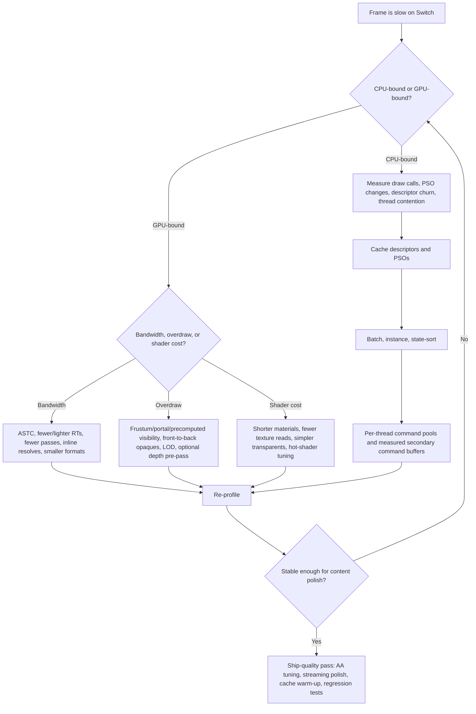

# Nintendo Switch Rendering Techniques and Engine Optimisations

## Executive summary

The most important practical truth about Switch rendering is that you should optimise for **bandwidth, state-change cost, and CPU submission efficiency before you chase exotic GPU tricks**. Public Tegra X1 material describes a Maxwell-class GPU with 256 CUDA cores, third-generation delta colour compression, 64 KB shared memory per SMM, and major gains from improved caching and compression; public press analyses commonly report a 64-bit LPDDR4 interface with **25.6 GB/s** bandwidth, **16 TMUs**, **16 ROPs**, and a **256 KB GPU L2** cache. On hardware with that profile, every unnecessary render-target write, texture fetch, descriptor update, or draw-call state change is expensive. citeturn5view0turn6view1turn6view2turn7search1

The second key point is architectural: **Switch is not a classic mobile TBDR in the PowerVR/Mali sense**. Maxwell introduced what NVIDIA briefed publicly as **tile caching**, but that is better thought of as an **immediate-mode renderer with locality-aware tile reuse and strong compression**, not a full tile-based deferred renderer with long-lived on-chip tile storage semantics. That distinction matters. Techniques that are mandatory on true tilers, such as carefully preserving tile-local attachment lifetimes across subpasses, are less directly portable to Switch than the more universal principles: reduce attachment traffic, keep formats compact, avoid unnecessary resolves, submit opaque front-to-back, and lean hard on compression-friendly content. citeturn15search3turn6view1turn14search0

The API story aligns with that hardware reality. NVIDIA and Nintendo publicly said they co-developed **NVN** for Switch as a lightweight gaming API, and public reverse-engineering work around **deko3d** consistently characterises NVN-like usage as low-level, explicit, and closer in spirit to Vulkan/DX12 than to OpenGL/DX11. Public Khronos listings also identified Switch hardware as conformant with **Vulkan 1.0**, **OpenGL 4.5**, and **OpenGL ES 3.2**. In practice, that means the winning engine architecture on Switch looks like this: **stable PSOs, cached descriptors, compact pass graphs, aggressive culling and LOD, per-thread command pools, secondary command buffers only where they pay, and no runtime pipeline compilation on the critical path**. citeturn8search4turn10search0turn40search4turn16search0turn16search5turn11search1

A high-confidence optimisation order for Switch is therefore:

| Priority | Do this first | Why it pays on Switch |
|---|---|---|
| Highest | Cut bandwidth: ASTC, fewer/lighter passes, smaller RTs, avoid extra resolves | Tegra X1’s external memory bandwidth is limited; Maxwell’s compression and cache help, but only if you keep traffic low. citeturn7search1turn6view1turn12search31turn38search0 |
| Highest | Reduce CPU submission cost: batch, sort state, cache descriptors, reuse command pools | Explicit APIs shift driver work to the engine; per-draw overhead still hurts on a modest ARM CPU. citeturn16search0turn36search0turn33search0 |
| High | Aggressive visibility and LOD | The cheapest draw is the one never submitted; this saves CPU and GPU simultaneously. citeturn39search0turn17search1turn20search6 |
| High | Eliminate pipeline/PSO hitches | Pipeline creation is costly; Unreal and Khronos both recommend precaching/caching. citeturn11search1turn18search2turn18search1 |
| Medium | Tune AA and depth strategy content-by-content | MSAA, pre-pass, and occlusion queries can help, but each has non-trivial trade-offs. citeturn38search0turn21search0turn17search1 |
| Medium | Micro-optimise shaders | Important, but after the frame architecture is already clean. citeturn27search2turn39search0 |

## Hardware and API realities

### What the Switch GPU is and is not

Public Tegra X1 documentation describes a Maxwell GPU with **256 CUDA cores**, support for modern graphics features such as tessellation and bindless textures, and materially improved compression over Tegra K1. The same whitepaper says Maxwell in Tegra X1 can reduce memory bandwidth by roughly **30% to 45%** versus Tegra K1 in NVIDIA’s tests because of improved caching and delta colour compression. It also explains the SMM memory hierarchy change: each SMM has **64 KB dedicated shared memory**, while L1 functionality is shared with the texture cache. citeturn5view0turn6view1turn6view2turn6view3

Public analyses of the GM20B/Tegra X1 configuration commonly report **2 SMMs**, **16 TMUs**, **16 ROPs**, a **256 KB L2 cache**, and a **64-bit LPDDR4** memory interface delivering **25.6 GB/s**. NVIDIA does not foreground all of those exact figures in the Tegra marketing whitepaper, so the cache/ROP breakdown should be treated as reputable public analysis rather than a Nintendo-cited SDK fact. citeturn7search1turn7search0

For Switch optimisation, the crucial nuance is that **Maxwell is not a classic tile-based deferred GPU**. NVIDIA later publicly briefed Maxwell/Pascal “tile caching” as using the **L2 cache** plus heuristics to process rasterisation in screen regions, but not in the same way as mobile TBDR architectures that fully accumulate a tile on-chip and only spill once. That means you should absolutely think about spatial locality and render-target traffic, but you should not assume Switch will reward TBDR-specific tricks exactly the way Mali or PowerVR would. citeturn15search3turn14search0

A concise public hardware fact sheet is below.

| Publicly described trait | Interpretation for optimisation |
|---|---|
| 256-core Maxwell GPU, 2 SMMs, desktop-class feature set citeturn5view0turn7search1 | Shader model is relatively flexible, but absolute throughput is modest by console standards. |
| 25.6 GB/s LPDDR4 bandwidth citeturn7search1turn7search0 | Treat bandwidth as the primary hard budget. |
| Third-gen delta colour compression, end-to-end memory compression citeturn6view1 | Content that preserves coherence and avoids random write/read patterns will benefit more. |
| 64 KB shared memory per SMM, L1 merged with texture cache citeturn6view2 | Texture locality and shader occupancy matter; register pressure can become an indirect limiter. |
| Publicly briefed “tile caching”, not full TBDR citeturn15search3turn14search0 | Prefer universal bandwidth reductions over tiler-only architectural assumptions. |

### NVN, Vulkan, and how Switch differs from OpenGL and older DirectX

NVIDIA’s public Switch announcement said **NVN** was built specifically to bring “lightweight, fast gaming” to the system, and Japanese reporting at launch described NVN as a gaming API co-developed by Nintendo and NVIDIA. Public reverse-engineering work around **deko3d**—explicitly described by its authors as a homebrew answer to the proprietary NVN API—says the model is low-level, explicit, and “reminiscent of Vulkan”, with devices, queues, command buffers, explicit resource management, and multiple processing queues. citeturn9search2turn8search4turn10search0

Public Khronos conformance reporting also tied Switch hardware to **Vulkan 1.0**, **OpenGL 4.5**, and **OpenGL ES 3.2**. That is useful context, but it does **not** mean commercial Switch rendering practice is best understood as “just Vulkan”. Publicly citable material on NVN itself is sparse because the API is proprietary. Accordingly, the safest engineering stance is: **think Vulkan/DX12 in engine architecture, but expect native Switch work to revolve around NVN and platform-specific tooling rather than generic desktop API assumptions**. citeturn40search4turn10search0

The practical differences are straightforward.

| API model | What the engine owns | What usually happens to performance |
|---|---|---|
| OpenGL / D3D11-style driver model | Most validation, state translation, and hidden synchronisation | Easier to start with, but worse CPU predictability and weaker multithread scaling. citeturn19search0turn16search0 |
| Vulkan / D3D12 / NVN-like explicit model | Command buffers, synchronisation, descriptor lifetime, pipeline layout/state boundaries | More work for the engine, but lower CPU overhead and better scalability when implemented well. citeturn16search0turn16search5turn11search0turn10search0 |

In other words, the Switch-native sweet spot is not “write clever shaders and hope the driver fixes the rest”. It is **build a disciplined explicit renderer**.

## Building a fast frame on Switch

A strong Switch frame is built around **predictable submission**. The engine should use **per-frame fences**, **per-thread command pools**, **stable descriptor or resource-layout caches**, and a submission schedule that never blocks the CPU waiting for the GPU except at known frame boundaries. Khronos’ threading guide recommends a separate command pool per thread and separate descriptor pools per thread because command pools and descriptor pool operations are externally synchronised. The command-buffer specification also makes clear that work recorded in different command buffers does not become visible to other work without explicit dependencies. citeturn16search0turn16search5turn16search2

A practical frame structure for Switch looks like this:

```cpp
// Pseudo-code for an NVN/Vulkan-like Switch frame
Frame& f = frames[frameIndex % kFramesInFlight];

// Safe point: GPU is done with this frame's transient resources
wait(f.fence);
reset(f.commandPoolsPerThread);
f.descriptorArena.reset();
f.dynamicBufferArena.reset();

// CPU work
updateStreamingRequests();
buildVisibleSet(camera);       // frustum -> portal/precomputed -> optional occlusion
buildLODSelections(camera);
sortDrawsByPassAndState();

// Record in parallel
parallel_for(thread in workers) {
    CmdBuf cmd = beginSecondary(f.pool[thread]);
    recordOpaqueDepthOptional(cmd, threadBin);
    recordOpaqueMain(cmd, threadBin);
    recordAlphaTest(cmd, threadBin);
    recordTransparent(cmd, threadBin);
    end(cmd);
}

// Primary submit
CmdBuf primary = beginPrimary(f.primaryPool);
beginMainPass(primary);
executeRecordedSecondaries(primary);
endMainPass(primary);
submit(primary, f.fence);
present();
```

That structure follows three evidence-backed ideas. First, **only update descriptors at a known safe point**—the start of the frame after the frame fence signals—unless you have deliberately built an update-after-bind model. Second, **secondary command buffers are worthwhile when they amortise enough work**; too many tiny secondaries are counterproductive. Third, **resetting command pools** is much cheaper than aggressively allocating/freeing command buffers every frame. citeturn26search4turn36search0

The command-buffer usage sample is especially relevant because it quantifies the trade-offs. In a scene with roughly **1,800 draw calls**, splitting work across **8 command buffers on 8 threads** improved performance by about **15%**. The same sample also found that “allocate and free” command-buffer management was the worst strategy, with request/reset work consuming **28.8%** of a capture, versus **1.16%** for individual resets and **0.45%** for command-pool resets. That is exactly the sort of CPU-side waste a Switch renderer cannot afford. citeturn36search0

### Batching, state sorting, instancing, and descriptor lifetime

On Switch, batching is still essential even though a low-overhead API reduces some driver work. Unity’s documentation remains useful here because it explains why draw calls are expensive: the cost is often the **state changes** and the validation/translation around them, not just the call itself. Unity also explicitly notes that dynamic batching can become a poor trade on consoles and modern low-overhead APIs because it burns CPU transforming vertices on the host. citeturn19search0turn20search2

That leads to a clear ordering strategy for Switch:

| Submission style | Use it when | Avoid it when |
|---|---|---|
| **Static batching / mesh clustering** | Static geometry shares material/shader and can still be culled sensibly | Memory duplication would explode; very large merged clusters hurt culling granularity. citeturn19search0turn20search7 |
| **GPU instancing** | Repeated meshes with identical geometry/material dominate the scene | Per-instance variation forces divergent materials or unique state. citeturn20search4turn19search5 |
| **State sorting** | Any opaque workload with many materials/PSOs | Never for transparents that require strict back-to-front composition. citeturn19search0turn33search0 |
| **Dynamic batching** | Small meshes only, and only if profiling proves a CPU win | Large vertex counts or modern low-overhead APIs where batching overhead outweighs draw overhead. citeturn19search0turn20search2 |

Descriptor lifetime is equally important. Khronos’ descriptor-management sample shows that naïvely resetting descriptor pools and allocating/updating descriptor sets every frame can be a major CPU bottleneck; in its CPU-heavy test, frame time fell from roughly **44 ms to 27 ms**—about a **38% decrease**—when descriptor sets were cached and reused. The same sample recommends caching descriptor sets, reusing descriptor pools, and using large per-frame buffers with dynamic offsets or stable offsets instead of per-draw allocation/update churn. citeturn33search0

A practical Switch-friendly policy is:

- keep **descriptor set layouts / resource layouts stable** for the whole title or level;
- use **push constants** for very small per-draw data;
- use **per-frame ring buffers** for dynamic constants;
- cache material descriptors permanently where possible;
- use **update-after-bind** only where it meaningfully simplifies streaming or bindless-style tables, not as a default everywhere. Static descriptor sets outperformed push constants in Khronos’ Arm Mali sample on load/store cycles, while dynamic descriptor offsets raised frame time from **16.7 ms to 20.9 ms** there because of additional per-frame offset work. Those are not Switch numbers, but they are strong warnings against per-draw descriptor churn on bandwidth- and CPU-limited hardware. citeturn35view0turn35view1turn33search0

If your engine architecture can support it, use a compact sort key for opaques:

```cpp
// 64-bit opaque sort key
key =
  (uint64_t(passClass)      << 60) |
  (uint64_t(psoHash)        << 32) |
  (uint64_t(materialHash)   << 16) |
  (uint64_t(depthBucket)    <<  0);

// Opaque: sort ascending (state-friendly, roughly front-to-back)
// Transparent: separate list, sort back-to-front by depth
```

That pattern is not Switch-specific, but it maps especially well to Switch because it reduces PSO changes, descriptor rebinding, and overdraw at the same time. citeturn19search0turn33search0

### Visibility, occlusion, and LOD

The cheapest Switch draw is the draw you never submit. Samsung’s GPU guidance is blunt: **view-frustum culling should always be considered**, because it eliminates redundant driver and GPU processing. Unreal’s visibility documentation adds a useful layered model: **distance culling**, then **frustum culling**, then **precomputed visibility**, then **dynamic occlusion**. That order is exactly right for Switch because it moves the cheapest decisions earlier and reserves GPU occlusion work for the residue. citeturn39search0turn17search1

Portal and precomputed visibility are particularly attractive on Switch for indoor or compartmentalised worlds. Arm notes that portal visibility can cull whole rooms and major in-frustum redundancy, while Unreal recommends **Precomputed Visibility** especially for lower-end hardware and mobile-class devices because it trades runtime rendering-thread cost for memory. On Switch that is frequently the correct bargain in corridor shooters, room-based games, and dense interior scenes. citeturn39search6turn17search1

Hardware occlusion queries are useful, but they should be treated as a **coarse backstop, not your primary visibility system**. Unreal notes that hardware occlusion query results are read back **one frame later**, which can cause pop-in under rapid camera movement, and that cost scales with the number of queries. On Switch, where CPU/GPU synchronisation mistakes are painful, that argues for a conservative use of queries: only on large occluders or large dynamic sets, after frustum/portal/distance pruning has already done the heavy lifting. citeturn17search1

LOD remains indispensable. Unity’s LOD Group documentation is basic but correct: swapping to simpler meshes as screen size falls reduces geometry cost and usually improves performance if used judiciously. The Switch-specific lesson is to make LOD do **triple duty**: fewer triangles, fewer overdraw-inducing silhouettes, and lower texture residency pressure through mip bias or reduced material complexity on lower LODs. Public Switch postmortems and analyses repeatedly show that successful ports accept more aggressive LOD transitions and dynamic resolution rather than protecting every last pixel of fidelity. citeturn20search6turn30search0turn30search2

A robust visibility stack for Switch is therefore:

```text
Distance cull
  -> Frustum cull
  -> Portal / precomputed visibility for indoor cells
  -> Optional coarse software HZB or hardware occlusion on big groups
  -> LOD decide
  -> Submit
```

## Bandwidth-first rendering decisions

### Depth pre-pass, early-Z, alpha test, and pass design

Even though Switch is not a classic TBDR, **early depth rejection is still one of the highest-value generic optimisations** for heavy opaque scenes. Samsung recommends submitting opaque draws first, front-to-back, with depth test/write enabled, then alpha-test/discard draws, then transparents. Arm similarly recommends front-to-back opaques with early depth/stencil, and warns that portal visibility and other high-level culling should be used to cut in-frustum redundancy before it ever reaches the rasteriser. citeturn39search0turn39search6

That yields a nuanced verdict on full depth pre-pass for Switch:

- **Use it** when your frame is dominated by expensive pixel shading, heavy overdraw, or very dense alpha-tested foliage/buildings where early depth dramatically reduces fragment work.
- **Do not default to it** when your scene is already CPU- or vertex-bound, because a pre-pass doubles scene traversal and depth submission cost.

That recommendation is an engineering inference rather than a first-party Switch rule, but it follows from the public behaviour of early depth/stencil and the Tegra X1’s overall bandwidth posture. citeturn39search0turn39search6turn7search1

Two things are consistently dangerous for early depth on modern GPUs: **`discard`** and **writing `gl_FragDepth`**. Samsung warns against discard-heavy fragment shaders because they can stall the pipeline; Arm’s fragment pre-pass guidance explains why late-Z paths do more work and recommends keeping any discard or depth-writing logic early and simple if it cannot be avoided. On Switch, alpha-tested foliage and masked materials should therefore be tightly budgeted, spatially clustered, and rendered after solid opaques have already built useful depth. citeturn39search0turn39search2

### MSAA and anti-aliasing trade-offs

AA on Switch is a balance between **edge quality**, **bandwidth**, and **frame stability**. Khronos’ MSAA sample shows why 4x MSAA can be surprisingly efficient on true tilers when the multisampled attachment stays transient and is resolved inline, but it also shows how catastrophic a separate resolve pass can be for bandwidth: in its Mali-G76 example, a bad separate resolve path added roughly **5 GB/s** of bandwidth, and the worst case described increased read/write bandwidth by **6.3 GB/s**. citeturn38search0turn38search1

Switch’s Maxwell-like GPU will not realise the exact same on-chip MSAA economics as a Mali tiler, but the lesson still holds: if you use MSAA, **resolve inline, keep multisampled attachments transient where possible, and never add standalone resolve passes casually**. Bandwidth remains the scarce resource. citeturn38search0turn6view1

For engine decisions, Epic’s forward-renderer guidance is useful. Unreal says forward shading gives a faster baseline than deferred in some content, supports both **MSAA** and **TAA**, and in Epic’s own tests **MSAA increased GPU frame time by about 25%** versus TAA. TAA usually removes more geometric and specular aliasing, but it can introduce blur; MSAA is often visually preferable in crisp forward-rendered content and VR-style motion, but its cost needs careful profiling. For Switch-class budgets, that translates well into the following rule: **prefer simple post AA or TAA-like methods for broad coverage, reserve MSAA for forward pipelines and content where edge quality is visibly worth the cost**. citeturn21search0turn21search3turn21search2

A practical recommendation matrix:

| Technique | Switch recommendation | Why |
|---|---|---|
| FXAA / simple post AA | Good default fallback | Very cheap; common fit for 30 fps Switch targets. citeturn21search2turn21search6 |
| TAA / temporal upsampling | Good when motion vectors and ghosting control are solid | Often better total cost/quality than MSAA, but blur and ghosting must be handled. citeturn21search0turn21search1 |
| 2x/4x MSAA in forward | Use selectively | Good edges, but bandwidth/RT footprint rises; inline resolves matter. citeturn38search0turn21search0 |
| High-sample MSAA | Usually avoid | Diminishing returns at Switch budgets. citeturn38search0 |

### Texture formats, ASTC, memory layout, and streaming

Texture compression is non-negotiable on Switch. ASTC is the obvious workhorse because it trades image quality against bitrate with a wide range of block sizes while keeping the block size fixed at **128 bits**. Arm’s ASTC guide gives the familiar 2D range: **4×4 = 8 bpp**, **6×6 = 3.56 bpp**, **8×8 = 2 bpp**, down to **12×12 ≈ 0.89 bpp**. Khronos’ own ASTC announcement emphasised the same point: ASTC exists to cut both memory footprint and **GPU memory bandwidth** while preserving flexibility. citeturn12search31turn12search2

A sane Switch compression policy is:

| Asset class | Conservative ASTC guidance |
|---|---|
| UI, masks, normals, hero assets | 4×4 or 5×5 |
| General albedo / roughness-metallic for close-to-mid assets | 6×6 |
| Distant props / landscape detail maps | 8×8 and above if artefacts are acceptable |
| Pixel-art / sharp authored content | Consider leaving uncompressed where artefacts are unacceptable, but budget it tightly |

That table is a practical recommendation inferred from ASTC’s rate table and Switch’s bandwidth limits; it should always be validated visually per title. citeturn12search31turn12search2turn7search1

Public Tegra X1 material also highlights **Tiled Resources / Sparse Texture** support. That matters because Switch-friendly streaming should be thought of as **mip- and residency-driven**, not just “load full textures later”. Where your engine supports sparse residency or virtual texturing, use it to keep only the necessary pages/mips resident; Ubisoft publicly presented **GPU-driven rendering plus virtual texturing** as part of the path to constant 60 fps in *Trials Rising*, with specific attention to Switch scalability. citeturn6view4turn29search1

On memory layout itself, public first-party documentation is limited. Tegra exposes the concepts of tiled resources, caching, and compression, but the exact production image-layout and swizzle details used in licensed Switch development are not publicly documented in a way that can be cited properly. The practical rule is therefore simple: **let the platform API or engine own GPU-optimal image layout; keep linear layouts for upload/staging only; and avoid forcing extra layout transitions, copies, or readbacks in the frame**. That is the low-risk policy consistent with Tegra’s published compression model and Vulkan’s explicit image-layout philosophy. citeturn6view1turn6view4turn36search2

### Shader optimisation and pipeline creation

Shader optimisation on Switch should follow a “**bandwidth first, divergence second, registers third**” heuristic. NVIDIA’s shader guidance for modern APIs recommends avoiding warp-divergent constant-buffer reads, preferring SRVs where access is divergent, and using manual bit packing where it reduces buffer and shared-memory pressure. Samsung’s guidance adds that reduced precision can reduce ALU cost and power on many mobile GPUs, but compilers may promote precision, so everything must be validated on target hardware. citeturn27search2turn39search0

For Switch specifically, that means:

- keep **pixel shaders short** if the scene is bandwidth- or overdraw-limited;
- prefer **coherent texture access** and stable material code paths;
- reduce interpolants and pack small flags/constants where it genuinely reduces memory traffic;
- treat reduced precision as a **profile-driven** optimisation, not a blanket assumption, because public Switch-specific NVN shader compiler guidance is not available. citeturn27search2turn39search0

Pipeline creation cost should be assumed expensive enough to matter. The Vulkan guide says pipeline creation can be “somewhat costly” because shaders may compile at creation time, and it explicitly recommends robust pipeline-cache systems. Unreal goes further by providing both **PSO Precaching** and **bundled PSO caches**, specifically to avoid hitching from runtime compilation. On Switch, the practical answer is uncompromising: **compile, serialise, and warm every PSO you can before gameplay; do not create pipelines in reaction to first visibility**. citeturn11search1turn18search2turn18search1

## Tooling and engine-specific patterns

### Profiling workflow that fits Switch-class problems

Public Tegra-adjacent tooling gives a good picture of how to profile Switch-like workloads even though the full licensed Nintendo toolchain is not publicly citable. NVIDIA’s older **Tegra Graphics Debugger** explicitly supported **Tegra X1** and Vulkan/OpenGL workflows, and NVIDIA now positions **Nsight Graphics** as the replacement, with frame capture, GPU trace, shader profiling, and pipeline-state inspection. RenderDoc remains the most broadly practical frame debugger for Vulkan/OpenGL workflows, and `VK_EXT_debug_utils` is the canonical way to make captures readable by naming objects and adding command-buffer regions. citeturn27search0turn27search7turn23search3turn24search5turn24search6

A disciplined workflow for Switch-class optimisation is:

1. **Name everything**: textures, buffers, passes, command buffers, queues.  
2. **Capture a representative bad frame** in Nsight/RenderDoc.  
3. **Classify the bottleneck**: CPU submission, bandwidth, overdraw, shader hot spots, PSO hitch, or visibility failure.  
4. **Fix one category at a time** and re-capture.  
5. **Only after frame architecture is stable**, go into shader-level analysis. citeturn24search5turn23search1turn23search3

If you use Unreal, **Unreal Insights** and **RDG Insights** are especially valuable because RDG can show resource lifetimes, transient memory layout, pass culling, async overlap, and pass merging. That is exactly the information you need when the problem is not a single bad shader but a wasteful frame graph. citeturn22search0turn22search2

### Unity

Public Unity documentation is not Switch-specific, but the patterns map very well to Switch:

- **Use SRP Batcher** when a scene has many materials sharing the same shader variants; Unity positions it as a CPU rendering optimisation for SRP-based projects. citeturn16search4
- Prefer **static batching** and **GPU instancing** over dynamic batching unless profiling proves otherwise. Unity explicitly warns that dynamic batching transforms vertices on the CPU and may not be advantageous on consoles or modern APIs. citeturn19search0turn20search2turn20search4
- Use **occlusion culling** carefully in indoor scenes where it eliminates meaningful overdraw and draw calls, but remember Unity also notes the runtime memory cost and CPU baking/runtime trade-off. citeturn16search1turn16search6
- Use **LOD Groups** aggressively and author them for screen-size thresholds that reflect handheld viewing distance as well as docked TV usage. citeturn20search6turn20search8

In practice, the Unity advice for Switch is simple: **URP or custom SRP, SRP Batcher on, dynamic batching viewed sceptically, instancing for repetition, static batching only where memory and culling granularity still make sense**. citeturn16search4turn19search0turn20search4

### Unreal

Public Unreal guidance maps even more directly to Switch-like explicit rendering:

- **Forward Shading** can provide a faster baseline than deferred for suitable content, and it is the path that enables **MSAA** in Unreal. Epic’s own documentation notes a roughly **25% GPU frame-time increase** for MSAA over TAA in its tests. citeturn21search0turn21search3
- Unreal’s recommended visibility stack—**distance**, **frustum**, **precomputed visibility**, then **dynamic occlusion**—is almost exactly the right Switch hierarchy. Hardware occlusion queries cost GPU work and respond a frame late. citeturn17search1turn17search2
- **PSO Precaching** should be enabled and validated. Unreal documents background compilation, component/resource precaching, and the need to avoid PSO misses that hitch during gameplay. citeturn18search2turn18search1
- **Render Dependency Graph** should be used for high-level rendering work because it automates split barriers, transient resource aliasing, pass culling, and parallel command-list recording. citeturn22search0

For Switch projects in Unreal, the most credible public advice is therefore: **use the simplest shading path that achieves the art target, get PSO precaching right, keep visibility budgets tight, and inspect the RDG graph when memory or pass count looks suspicious**. citeturn21search0turn18search2turn22search0

### Custom engines and public source-code stand-ins

Because Nintendo’s official NVN SDK samples are not publicly citable, the best public stand-ins are **deko3d**, **uam**, and the **Khronos Vulkan Samples**. They are genuinely useful.

- **deko3d** is a public low-level graphics API for Switch homebrew, explicitly described as the homebrew answer to NVN and shaped by reverse-engineering NVN’s design. It exposes devices, queues, command buffers, explicit resource management, and compile-time asset workflows. citeturn10search0
- **uam** is a Tegra X1-targeting shader compiler for deko3d and shows a Switch-like explicit binding model with required explicit bindings. citeturn10search3
- **Khronos Vulkan Samples** provide source-backed examples for the problems that matter most on Switch-class hardware: **push descriptors**, **descriptor indexing**, **pipeline cache**, **descriptor management**, **command-buffer usage**, **pipeline barriers**, and **MSAA**. Each sample page links to the GitHub source. citeturn32search1turn32search2turn33search3turn33search0turn36search0turn36search2turn38search0

One extra public postmortem pattern is worth calling out. While porting *Warframe* to Switch, Digital Extremes’ Steve Sinclair publicly reported that Panic Button fixed a **critical section synchronisation issue between visibility jobs**, saving roughly **1 ms+** on Xbox One and PS4 as a side effect. Even though that is not a Switch GPU metric, it is exactly the type of CPU-side threading bug that kills Switch performance disproportionately. citeturn31search4

## Recommended optimisation order

### What to do first, second, and last

The checklist below is the highest-confidence optimisation sequence for a serious Switch renderer.

| Order | Task | Why it should be this early |
|---|---|---|
| First | Establish hard budgets for frame time, bandwidth, memory, draw calls, materials, and visible lights | Without budgets, later optimisation is random. Tegra X1’s bandwidth ceiling makes this non-optional. citeturn7search1turn6view1 |
| First | Compress textures with ASTC, prune RT formats, lower attachment count, remove redundant passes/resolves | This attacks the dominant Switch constraint immediately. citeturn12search31turn12search2turn38search0 |
| First | Implement frustum culling, distance culling, and LOD | These save CPU and GPU together. citeturn39search0turn17search1turn20search6 |
| First | Cache descriptors/material bindings and pre-create PSOs | Prevents CPU churn and first-use hitches. citeturn33search0turn11search1turn18search2 |
| Second | Sort opaque draws by PSO/material and roughly front-to-back | State-change reduction plus early-Z advantage. citeturn19search0turn39search6 |
| Second | Move to per-thread command pools and measured multithreaded recording | Strong CPU-side gains when large scenes justify it. citeturn16search0turn36search0 |
| Second | Add portal/precomputed visibility and coarse occlusion | Especially valuable in indoor scenes. citeturn39search6turn17search1 |
| Third | Evaluate depth pre-pass, MSAA level, post AA, and transparent/material simplifications | These can win a lot, but only after the frame is structurally healthy. citeturn38search0turn21search0turn39search0 |
| Last | Hand-tune hot shaders, precision, packing, and special-case material branches | High leverage only once architecture issues are removed. citeturn27search2turn39search0 |

### Decision flow

The following decision flow is the practical version of the report’s recommendations.



### A good frame graph

This is the frame shape you should generally be aiming at.

```mermaid
flowchart LR
    A[CPU simulate and streaming] --> B[Visibility and LOD]
    B --> C[Build draw lists]
    C --> D[Sort opaque by pass and state]
    D --> E[Record command buffers in parallel]
    E --> F[Optional depth pre-pass for overdraw-heavy content]
    F --> G[Opaque main pass]
    G --> H[Alpha-tested masked pass]
    H --> I[Transparent pass]
    I --> J[Post-process and UI]
    J --> K[Present]
```



### Measurable patterns worth trusting

The public data points below are not Switch benchmarks, but they are among the most relevant quantified patterns for a Switch-class renderer because they measure exactly the same categories of pain: CPU command overhead, descriptor churn, synchronisation bubbles, and bandwidth.

| Pattern | Public measured result | Why it matters for Switch |
|---|---|---|
| Descriptor set caching | **44 ms → 27 ms** frame time in a CPU-heavy scene, about **38%** improvement. citeturn33search0 | Switch CPU time is precious; per-frame descriptor churn is a common hidden cost. |
| Multithreaded command recording | About **15%** speed-up at ~1,800 draw calls with 8 buffers across 8 threads. citeturn36search0 | Worth doing once the renderer is draw-call heavy enough. |
| Command-pool reset vs allocate/free | Allocate/free command buffers consumed **28.8%** of one capture versus **0.45%** for pool reset. citeturn36search0 | Absolute confirmation that transient command allocation strategy matters. |
| Better pipeline barrier staging | Relaxing a barrier from conservative to fragment-only consumption improved frame time by **13%**. citeturn37view0turn37view1 | Over-synchronisation can quietly starve the GPU. |
| Inline MSAA resolve vs separate resolve | 4x MSAA with inline resolve added only about **3%** bandwidth in one tiler case; bad resolve paths added around **5 GB/s**. citeturn38search0 | On any bandwidth-constrained GPU, resolves must be designed, not appended. |
| Dynamic UBO offsets vs static descriptors | In one Mali sample, frame time went from **16.7 ms to 20.9 ms** with dynamic descriptor offsets. citeturn35view1 | Per-draw “flexibility” can be slower than stable bindings. |

## Open questions and limitations

Some of the material you explicitly asked for—especially **official NVN reference documentation, Nintendo SDK samples, and Nintendo’s first-party Switch profiling tools**—is not publicly citable. Public information on NVN is limited to launch statements and reverse-engineered/public stand-ins such as **deko3d**. Accordingly, the report is strongest where it relies on official NVIDIA/Khronos/Unreal/Unity documentation, and more interpretive where it maps those findings onto proprietary Switch-native practice. citeturn8search4turn10search0turn27search0

Public sources also do not expose every microarchitectural detail of the Switch GPU. For example, the **256 KB GPU L2**, **16 ROP**, and some other fine-grained GM20B details are widely reported by reputable analyses, but not foregrounded in Nintendo-public documentation. Those figures are therefore included as **publicly reported** rather than “first-party confirmed by Nintendo SDK pages”. citeturn7search1turn7search0

Within those limitations, the conclusions are still robust: **optimise Switch as a constrained Maxwell system with explicit-API discipline, not as a magical black box**. If you reduce bandwidth, stabilise PSOs, cache descriptors, minimise synchronisation stalls, and keep visibility/LOD aggressive, you will usually unlock far more performance than you would from isolated shader heroics alone. citeturn6view1turn33search0turn36search0turn37view1turn38search0